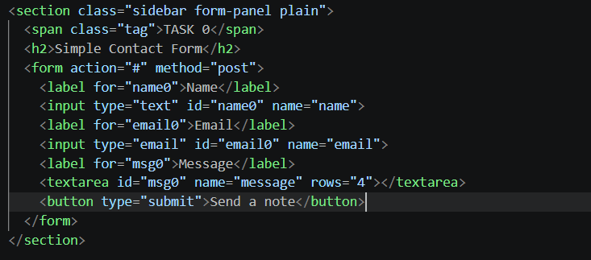
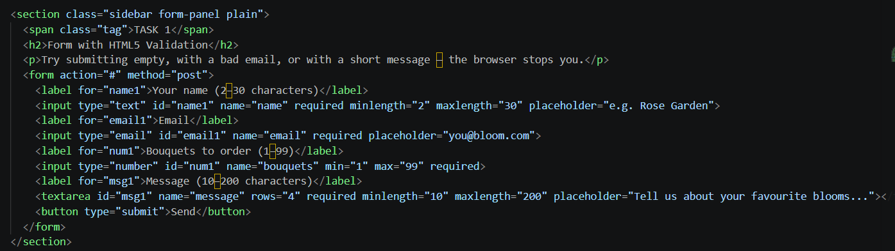
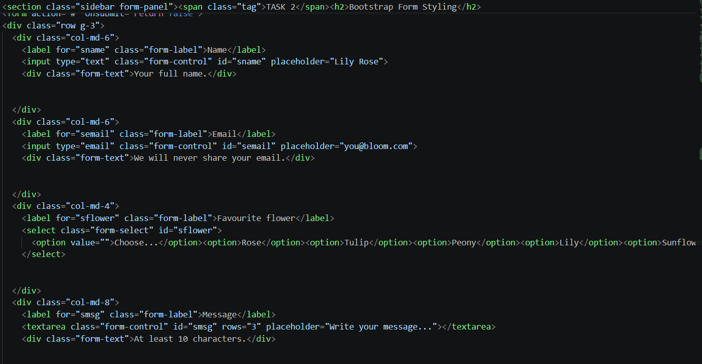
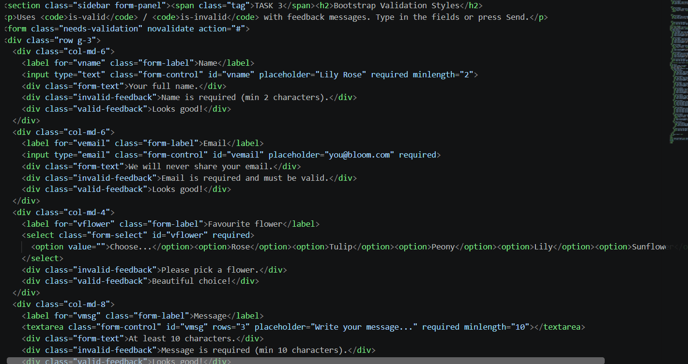
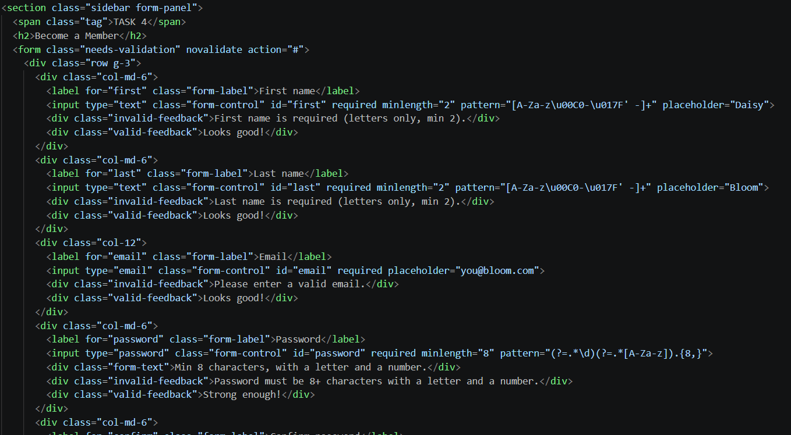

## Assignment 4:Forms and Validation
### Akerke Berdakul IT-2503
## Part 1. Basic HTML Forms

### Task 0. Simple Contact Form
•	Create a basic contact form with the following fields:
o	Name (text input)
o	Email (email input)
o	Message (textarea)
o	Submit button
•	Ensure all fields have proper <label> elements.

### Task 1. Form with HTML5 Validation
•	Add built-in validation attributes (required, type, ma5xlength, etc.).
•	Test how the browser enforces validation (e.g., email format, empty fields).

## Part 2. Bootstrap Forms

### Task 2. Bootstrap Form Styling
•	Recreate the contact form using Bootstrap form classes.
•	Use Bootstrap’s grid system to arrange form fields neatly.
•	Add placeholders and helper text where appropriate.

### Task 3. Bootstrap Validation Styles
•	Apply Bootstrap’s validation feedback classes (is-valid, is-invalid).
•	Show feedback messages below inputs (e.g., “Email is required”, “Looks good!”).
•	Test the form by entering valid and invalid data.

## Part 3. Advanced Form Project

### Task 4. Registration Form
•	Create a registration form for a website. It should include:
o	First Name, Last Name
o	Email
o	Password + Confirm Password
o	Gender (radio buttons)
o	Hobbies (checkboxes)
o	Country (select dropdown)
o	Submit and Reset buttons
•	Style the form with Bootstrap Grid so it is responsive.
•	Add HTML5 validation (e.g., password must have minimum length).
•	Add Bootstrap validation feedback to display error/success messages.

## Summary

To sum up, I created an website with simple form ,form with html5 validation , bootstrap form styling, bootstrap form with validation and advanced registration from using previous  parts.
